<div align="center">

# Kali Linux for Beginners

**A free, hands-on path from your first shell command to pulling a password out of captured network traffic, with a safe practice lab that runs on your own laptop.**

[**Start the course**](https://tmhsdigital.github.io/Kali-Linux-for-beginners/) &middot;
[Quickstart](#quickstart) &middot;
[Curriculum](#curriculum) &middot;
[Cheatsheets](#cheatsheets) &middot;
[Teaching guide](guides/teaching-with-this-course.md)

[](https://github.com/TMHSDigital/Kali-Linux-for-beginners/actions/workflows/ci.yml)
[](https://tmhsdigital.github.io/Kali-Linux-for-beginners/)
[](LICENSE)
[](https://codespaces.new/TMHSDigital/Kali-Linux-for-beginners)



<sub>Real output from the practice lab, using commands from modules 03 and 05.</sub>

</div>

## About

Five modules take you from the Linux shell to network scanning, wireless
attacks, and packet analysis. Every technique gives the command, the output it
prints in the practice lab, and how a defender spots or stops it. Lab checks in
modules 01, 02, 03, and 05 print PASS or FAIL so you know when you have it.

It is written for complete beginners. You need a laptop with 8 GB of RAM and
Docker, or a free GitHub account to use Codespaces instead. Module 04's live
wireless work also needs a USB Wi-Fi adapter. Plan on about 18 hours. It's free,
needs no account or VPN, and works offline. Learn the foundations here, then
take them to hosted platforms like TryHackMe or Hack The Box Academy.

> [!WARNING]
> **For education and authorized testing only.** Using these techniques against
> systems, networks, or wireless access points you do not own or lack written
> permission to test is illegal in most jurisdictions. Every example targets the
> bundled lab, `127.0.0.1`, or documentation address ranges. You are responsible
> for your own actions. See the [full disclaimer](LICENSE).

## Quickstart

```bash
git clone https://github.com/TMHSDigital/Kali-Linux-for-beginners.git
cd Kali-Linux-for-beginners
./scripts/setup-lab-env.sh              # check Docker, start the lab
./scripts/setup-lab-env.sh user-shell   # shell as the normal user kali: modules 01-02
./scripts/setup-lab-env.sh shell        # root shell on the attacker: modules 03-05
```

The first run downloads Kali, so give it a few minutes. Stop the lab with
`./scripts/setup-lab-env.sh down`, or reset the targets to a clean state with
`./scripts/setup-lab-env.sh reset` (your files in `workspace/` are kept). If it
won't start, see [Lab troubleshooting](guides/lab-troubleshooting.md).

**No Docker?** Click the **Codespaces** badge above. The lab builds and starts
in a browser-based VS Code. Then run `./scripts/setup-lab-env.sh user-shell`.
Everything except live wireless (module 04) works there. Codespaces is free up
to GitHub's monthly quota, so stop the codespace when you're done.

## Curriculum

| Level | Module | Time | You will be able to |
|-------|--------|------|---------------------|
| 0 &middot; Fundamentals | [01. Terminal & Linux Core](01-terminal-and-linux-core/) | ~3 h | Navigate, inspect, and manipulate Linux from the shell; use pipes and redirection |
| 1 &middot; Administration | [02. System Admin & Privileges](02-system-admin-and-privileges/) | ~4 h | Read the Unix privilege model; audit SUID and sudo for escalation surface |
| 2 &middot; Recon | [03. Network Recon & Nmap](03-network-recon-and-nmap/) | ~4 h | Map a network and choose the right scan for stealth, speed, or depth |
| 2 &middot; Wireless | [04. Wireless Security & Aircrack-ng](04-wireless-security-aircrack/) | ~4 h | Capture and crack a WPA2 handshake in a lab; understand WPA3 and PMF defenses |
| 3 &middot; Forensics | [05. Packet Analysis & Wireshark](05-packet-analysis-wireshark/) | ~3 h | Reassemble sessions, extract cleartext credentials, and describe the fix |

Take them in order. Commands are tagged by depth (`[Level 0: Fundamental]`,
`[Level 1: Intermediate]`, `[Level 2+: Advanced / Field Ops]`) so you can tell
what to learn now and what to come back to.

The modules read fine here on GitHub. The
[docs site](https://tmhsdigital.github.io/Kali-Linux-for-beginners/) adds
full-text search, progress tracking, glossary definitions on hover, and offline
reading, with no third-party scripts.

## The practice lab

`docker compose` starts three containers on a private `10.77.0.0/24` bridge:

| Host | Address | Purpose |
|------|---------|---------|
| `attacker` | `10.77.0.5` | Kali toolbox (nmap, tshark, tcpdump, ftp, curl). Run the modules from here. |
| `web-target` | `10.77.0.10` | Plain-HTTP login form for intercepting cleartext credentials |
| `ftp-service` | `10.77.0.20` | vsftpd with anonymous and `labuser`/`labpass` logins, all cleartext |

It works the same on Linux, Docker Desktop (Windows/macOS), and WSL2. With
Docker Desktop the `10.77.0.x` addresses aren't reachable from your host, so run
module commands from `./scripts/setup-lab-env.sh shell`. Anything you save in
`/root/work` there shows up in `workspace/` in your clone. The targets are also
published on `127.0.0.1:8080` (web) and `127.0.0.1:2121` (FTP).

<details>
<summary><b>Running Kali yourself</b> (bare-metal, VirtualBox, VMware, WSL2)</summary>

<br>

You need Kali Linux, or any Debian-based distro. Pick the path that matches your
hardware:

- **Bare-metal**: best wireless performance and unrestricted access to internal
  radios. Required for reliable monitor-mode work (module 04).
- **VirtualBox**: install the Extension Pack for USB passthrough; allocate at
  least 2 vCPU, 4 GB RAM, and 40 GB disk; use Host-Only or NAT Network to
  isolate the lab.
- **VMware Workstation/Fusion**: smoother USB passthrough for RTL8812AU-class
  Wi-Fi adapters; use a Host-Only `vmnet` to fence off the lab.
- **WSL2**: `wsl --install -d kali-linux` gives the full CLI toolchain, but has
  no native 802.11 radio access. Use it for modules 01-03 and 05 (analyzing
  saved captures with `tshark`), and use bare-metal or a full VM for live
  wireless.

</details>

<details>
<summary><b>Recommended Wi-Fi adapters</b> (monitor mode and injection, module 04)</summary>

<br>

| Adapter | Chipset | Notes |
|---------|---------|-------|
| Alfa AWUS036NHA | Atheros AR9271 | 2.4 GHz; `ath9k_htc` is in-kernel and works without extra drivers. Good first adapter. |
| Alfa AWUS036ACH | Realtek RTL8812AU | Dual-band; needs the out-of-tree DKMS driver |
| TP-Link TL-WN722N v1 | Atheros AR9271 | Only v1 uses the Atheros chip; check the label |

Driver compilation and VM USB passthrough are covered in
[04/hardware-and-setup.md](04-wireless-security-aircrack/hardware-and-setup.md).

</details>

## Cheatsheets

| Cheatsheet | Covers |
|---|---|
| [Kali survival commands](cheatsheets/01-kali-survival-commands.md) | Files, processes, users, networking, and packages from the shell |
| [Nmap tactical reference](cheatsheets/02-nmap-tactical-reference.md) | Targets, host discovery, scan types, timing, NSE, and output formats |
| [Aircrack-ng workflow](cheatsheets/03-aircrack-workflow.md) | Monitor mode to cracked handshake, step by step |
| [Wireshark BPF and display filters](cheatsheets/04-wireshark-bpf-and-display.md) | BPF capture filters, display filters by protocol, and tshark essentials |

All four print cleanly from the docs site. New terms are defined in the
[glossary](guides/glossary.md).

## Teaching and contributing

Running it for a class, club, or study group? The
[teaching guide](guides/teaching-with-this-course.md) covers lab options, a
six-session schedule, and how to handle the wireless module safely. Questions
and show-and-tell go in
[Discussions](https://github.com/TMHSDigital/Kali-Linux-for-beginners/discussions).

Found a broken command or wrong output?
[Open an issue](https://github.com/TMHSDigital/Kali-Linux-for-beginners/issues/new/choose).
Want to fix it or write a module? [CONTRIBUTING.md](CONTRIBUTING.md) has the
content rules, how the repo and the docs site fit together, and the checks CI
runs. For a security problem in the lab or scripts, follow
[SECURITY.md](SECURITY.md) instead of opening a public issue. Changes are listed
in the [changelog](CHANGELOG.md), and the project follows a
[Code of Conduct](CODE_OF_CONDUCT.md).

## Credits

The curriculum follows the concepts in freeCodeCamp's *Hands-On Cybersecurity
and Ethical Hacking* by Sunny Malu, reorganized into modules with a practice
lab, real expected output, and defensive notes.

## License

[MIT](LICENSE), with an educational and authorized-testing disclaimer.

---

<div align="center">

<sub>Built by <a href="https://github.com/TMHSDigital">TMHSDigital</a> &middot; Practice only on systems you own or have written permission to test.</sub>

</div>
