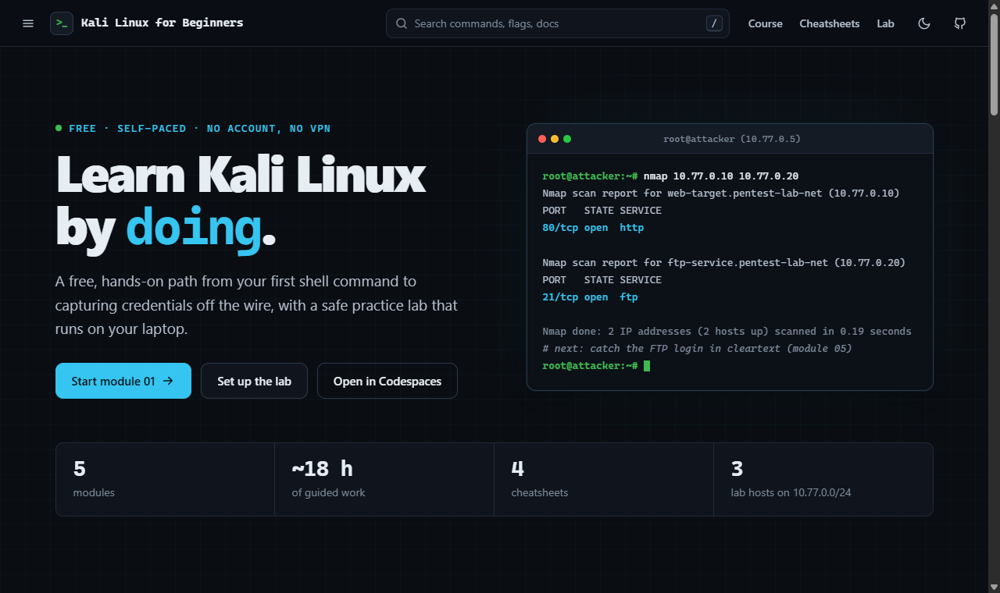

<div align="center">

# Kali Linux for Beginners

**A free, hands-on path from your first shell command to pulling a password out of captured network traffic, with a safe practice lab that runs on your own laptop.**

[**Start the course**](https://tmhsdigital.github.io/Kali-Linux-for-beginners/) &middot;
[Quickstart](#quickstart) &middot;
[Curriculum](#curriculum) &middot;
[Cheatsheets](#cheatsheets) &middot;
[Teaching guide](guides/teaching-with-this-course.md)

[](https://github.com/TMHSDigital/Kali-Linux-for-beginners/actions/workflows/ci.yml)
[](https://tmhsdigital.github.io/Kali-Linux-for-beginners/)
[](LICENSE)
[](https://github.com/TMHSDigital/Kali-Linux-for-beginners/commits/main)
<br>
[](#curriculum)
[](#curriculum)
[](#the-practice-lab)
[](https://codespaces.new/TMHSDigital/Kali-Linux-for-beginners)
[](CONTRIBUTING.md)

[](https://tmhsdigital.github.io/Kali-Linux-for-beginners/)

</div>

## Why this course

- **A real lab, not screenshots.** One command starts a Kali attacker box and
  deliberately insecure targets on a private Docker network. You scan them,
  sniff them, and log in to them.
- **Command, real output, and the defense, every time.** Each technique shows
  what to run, what it prints in the lab, and what it looks like to the blue
  team, so you learn an attack from both sides.
- **Self-grading.** Lab checks in modules 01 and 02 print PASS or FAIL, so you
  know when you have it.
- **Offline and account-free.** No sign-ups, no VPN, no time limits. Clone it,
  or open it in Codespaces with nothing installed.

| Who it's for | What you need | How long it takes |
|---|---|---|
| Complete beginners to Linux and security, and anyone who wants a hands-on refresher | A laptop with 8 GB RAM and Docker, or a free GitHub account for Codespaces. No prior Linux needed. A Wi-Fi adapter only for module 04's live work. | About 18 hours across five modules, at your own pace |

> [!WARNING]
> **For education and authorized testing only.** Using these techniques against
> systems, networks, or wireless access points you do not own or lack written
> permission to test is illegal in most jurisdictions. Every example targets the
> bundled lab, `127.0.0.1`, or documentation address ranges. You are responsible
> for your own actions. See the [full disclaimer](LICENSE).

## Quickstart

```bash
# 1. Clone
git clone https://github.com/TMHSDigital/Kali-Linux-for-beginners.git
cd Kali-Linux-for-beginners

# 2. Launch the practice lab (Docker required; the first run downloads Kali)
./scripts/setup-lab-env.sh          # checks Docker + subnet, starts it, waits for health
#   or: docker compose up -d --build

# 3. Get a shell on the Kali attacker box that sits on the lab network
./scripts/setup-lab-env.sh shell

# 4. Open module 01 (or the docs site) and start
```

Stop the lab with `./scripts/setup-lab-env.sh down` (or `docker compose down`).

**No Docker? Use Codespaces.** Click the **Codespaces** badge above. You get a
browser-based VS Code where the lab builds and starts on its own (the first
launch takes a few minutes while Kali downloads). Run
`./scripts/setup-lab-env.sh shell` and start at module 01. Modules 01-03 and 05
work fully there; live wireless (module 04) needs real hardware. Codespaces is
free up to GitHub's monthly quota, so stop the codespace when you're done.

<p align="right"><a href="#kali-linux-for-beginners">Back to top</a></p>

## Curriculum

Four levels across five modules. Read them on the
[docs site](https://tmhsdigital.github.io/Kali-Linux-for-beginners/) (search,
progress tracking, offline support) or right here on GitHub.

| Level | Module | Time | You will be able to |
|-------|--------|------|---------------------|
| 0 &middot; Fundamentals | [01. Terminal & Linux Core](01-terminal-and-linux-core/) | ~3 h | Navigate, inspect, and manipulate Linux from the shell; use pipes and redirection |
| 1 &middot; Administration | [02. System Admin & Privileges](02-system-admin-and-privileges/) | ~4 h | Read the Unix privilege model; audit SUID and sudo for escalation surface |
| 2 &middot; Recon | [03. Network Recon & Nmap](03-network-recon-and-nmap/) | ~4 h | Map a network and choose the right scan for stealth, speed, or depth |
| 2 &middot; Wireless | [04. Wireless Security & Aircrack-ng](04-wireless-security-aircrack/) | ~4 h | Capture and crack a WPA2 handshake in a lab; understand WPA3 and PMF defenses |
| 3 &middot; Forensics | [05. Packet Analysis & Wireshark](05-packet-analysis-wireshark/) | ~3 h | Reassemble sessions, extract cleartext credentials, and describe the fix |

Commands are tagged by depth so you can find your level:
`[Level 0: Fundamental]`, `[Level 1: Intermediate]`, `[Level 2+: Advanced / Field Ops]`.

New to all of this? Start at [module 01](01-terminal-and-linux-core/), do its
lab exercises, then continue in order with the [cheatsheets](#cheatsheets) open
alongside.

<p align="right"><a href="#kali-linux-for-beginners">Back to top</a></p>

## The practice lab

`docker compose` brings up three containers on a private `10.77.0.0/24` bridge:

| Host | Address | Purpose |
|------|---------|---------|
| `attacker` | `10.77.0.5` | Kali toolbox (nmap, tshark, tcpdump, ftp, curl). Run the modules from here. |
| `web-target` | `10.77.0.10` | Plain-HTTP login form for intercepting cleartext credentials |
| `ftp-service` | `10.77.0.20` | vsftpd with anonymous and `labuser`/`labpass` logins, all cleartext |

A real scan from the attacker shell:

```text
root@attacker:~# nmap 10.77.0.10 10.77.0.20
Nmap scan report for web-target.pentest-lab-net (10.77.0.10)
PORT   STATE SERVICE
80/tcp open  http

Nmap scan report for ftp-service.pentest-lab-net (10.77.0.20)
PORT   STATE SERVICE
21/tcp open  ftp

Nmap done: 2 IP addresses (2 hosts up) scanned in 0.19 seconds
```

The attacker box works the same on Linux, Docker Desktop (Windows/macOS), and
WSL2. With Docker Desktop the `10.77.0.x` addresses aren't reachable from your
host, so run module commands from `./scripts/setup-lab-env.sh shell`. The repo
is mounted read-only at `/lab`, and anything you save in `/root/work` shows up
in `workspace/` in your clone. From the host, the targets are also published on
`127.0.0.1:8080` (web) and `127.0.0.1:2121` (FTP).

<details>
<summary><b>Running Kali yourself</b> (bare-metal, VirtualBox, VMware, WSL2)</summary>

<br>

You need Kali Linux, or any Debian-based distro. Pick the path that matches your
hardware:

- **Bare-metal**: best wireless performance and unrestricted access to internal
  radios. Required for reliable monitor-mode work (module 04).
- **VirtualBox**: install the Extension Pack for USB passthrough; allocate at
  least 2 vCPU, 4 GB RAM, and 40 GB disk; use Host-Only or NAT Network to
  isolate the lab.
- **VMware Workstation/Fusion**: smoother USB passthrough for RTL8812AU-class
  Wi-Fi adapters; use a Host-Only `vmnet` to fence off the lab.
- **WSL2**: `wsl --install -d kali-linux` gives the full CLI toolchain, but has
  no native 802.11 radio access. Use it for modules 01-03 and 05 (analyzing
  saved captures with `tshark`), and use bare-metal or a full VM for live
  wireless.

</details>

<details>
<summary><b>Recommended Wi-Fi adapters</b> (monitor mode and injection, module 04)</summary>

<br>

| Adapter | Chipset | Notes |
|---------|---------|-------|
| Alfa AWUS036NHA | Atheros AR9271 | 2.4 GHz; `ath9k_htc` is in-kernel and works without extra drivers. Good first adapter. |
| Alfa AWUS036ACH | Realtek RTL8812AU | Dual-band; needs the out-of-tree DKMS driver |
| TP-Link TL-WN722N v1 | Atheros AR9271 | Only v1 uses the Atheros chip; check the label |

Driver compilation and VM USB passthrough are covered in
[04/hardware-and-setup.md](04-wireless-security-aircrack/hardware-and-setup.md).

</details>

<p align="right"><a href="#kali-linux-for-beginners">Back to top</a></p>

## Cheatsheets

| Cheatsheet | Covers |
|---|---|
| [Kali survival commands](cheatsheets/01-kali-survival-commands.md) | Files, processes, users, networking, and packages from the shell |
| [Nmap tactical reference](cheatsheets/02-nmap-tactical-reference.md) | Targets, host discovery, scan types, timing, NSE, and output formats |
| [Aircrack-ng workflow](cheatsheets/03-aircrack-workflow.md) | Monitor mode to cracked handshake, step by step |
| [Wireshark BPF and display filters](cheatsheets/04-wireshark-bpf-and-display.md) | BPF capture filters, display filters by protocol, and tshark essentials |

All four print cleanly from the docs site.

## How this compares

This project complements platforms like TryHackMe and Hack The Box Academy
rather than replacing them:

| | This project | Hosted platforms |
|---|---|---|
| Cost | Free, MIT licensed | Free tiers, paid for most content |
| Account / VPN | None | Account, often a VPN connection |
| Where the lab runs | Your machine or your Codespace, works offline | Their cloud |
| Defensive notes | On every technique | Varies by room or course |
| Depth | Beginner foundations | Beginner to advanced |

A good route is to work through these modules first, then move to a hosted
platform for more targets.

## Teaching with this course

Running it for a class, club, or study group? The
[teaching guide](guides/teaching-with-this-course.md) covers lab options, a
six-session schedule, and how to handle the wireless
module safely. Questions and show-and-tell go in
[Discussions](https://github.com/TMHSDigital/Kali-Linux-for-beginners/discussions).

<p align="right"><a href="#kali-linux-for-beginners">Back to top</a></p>

## Project structure

<details>
<summary><b>Repository layout</b></summary>

<br>

```text
Kali-Linux-for-beginners/
├── 01-terminal-and-linux-core/       # Level 0
├── 02-system-admin-and-privileges/   # Level 1
├── 03-network-recon-and-nmap/        # Level 2
├── 04-wireless-security-aircrack/    # Level 2
├── 05-packet-analysis-wireshark/     # Level 3
├── cheatsheets/                      # Quick reference
├── guides/                           # Teaching with this course
├── lab/                              # Lab images: attacker, web-target, ftp-service
├── scripts/
│   ├── setup-lab-env.sh              # Guarded lab launcher
│   ├── parse-nmap-xml.py             # Nmap XML to terminal table
│   └── build-site.py                 # Generates the docs site from the repo
├── site/                             # Docs site assets (CSS, JS, service worker)
├── tests/                            # pytest for the scripts, lab smoke test
├── docker-compose.yml                # Practice lab (attacker + targets)
└── .github/workflows/ci.yml          # Lint, tests, lab smoke test, site deploy
```

Turn an Nmap scan into a readable table:

```bash
nmap -sV -oX - 10.77.0.10 | parse-nmap-xml.py -     # in the attacker shell (on PATH)
# from your own clone instead: ./scripts/parse-nmap-xml.py scan.xml
```

</details>

<details>
<summary><b>How the docs site is built</b></summary>

<br>

The [docs site](https://tmhsdigital.github.io/Kali-Linux-for-beginners/) is
generated from this repository by
[`scripts/build-site.py`](scripts/build-site.py) on every push to `main`. It
walks the repo, builds the navigation from the directory structure, takes each
page's title from its first heading, and pre-renders every page to static HTML,
so each document has its own URL, link preview, and search-engine entry. Adding
a module or cheatsheet is enough for it to appear.

The site has full-text search that finds commands (not just titles), per-browser
progress tracking, dark and light themes, an "On this page" outline, printable
cheatsheets, and offline support after your first visit. It loads no
third-party scripts, and its Content-Security-Policy is `script-src 'self'`.

Preview it locally:

```bash
pip install -r requirements-dev.txt        # markdown-it-py + Pygments (+ test tools)
python scripts/build-site.py --out _site
cd _site && python -m http.server 8099     # open http://127.0.0.1:8099
```

</details>

## Contributing

Contributions are welcome, from typo fixes to new modules. Content is Markdown;
adding a `NN-topic/` folder with a `README.md` is all it takes for a new module
to show up on the site. Every technique needs the command, its real output from
the lab, and a defensive note. See [CONTRIBUTING.md](CONTRIBUTING.md) for the
content rules and the local checks CI runs (ruff, pytest, shellcheck, the lab
smoke test, and an offline link check).

- **Found a mistake or a broken command?** [Open an issue](https://github.com/TMHSDigital/Kali-Linux-for-beginners/issues/new/choose).
- **Security problem in the lab or scripts?** Please follow [SECURITY.md](SECURITY.md) rather than opening a public issue.
- **What changed?** See the [changelog](CHANGELOG.md).

This project follows a [Code of Conduct](CODE_OF_CONDUCT.md).

## Credits

The curriculum follows the concepts in freeCodeCamp's *Hands-On Cybersecurity
and Ethical Hacking* by Sunny Malu, reorganized into modules with a practice
lab, real expected output, and defensive notes.

## License

[MIT](LICENSE), with an educational and authorized-testing disclaimer.

---

<div align="center">

<sub>Built by <a href="https://github.com/TMHSDigital">TMHSDigital</a> &middot; Practice only on systems you own or have written permission to test.</sub>

</div>
